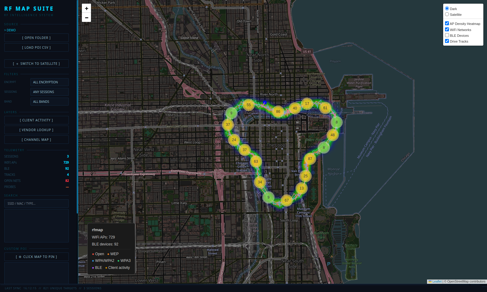

# rfmap (free CLI edition)


*The desktop app, RF Map Suite. The free CLI produces the same map as a standalone HTML file.*

Turns Marauder, AWOK and WiGLE wardrive logs into a single offline HTML map. Includes
cross-session de-duplication, an encryption-colored AP layer, a heatmap, BLE, drive
tracks, GPX and watch mode.

```bash
python3 -m venv .venv && .venv/bin/pip install -r requirements.txt
.venv/bin/python samples/make_samples.py            # synthetic demo data
.venv/bin/python rfmap.py samples/demo --out map.html
```

**Want the desktop app?** RF Map Suite adds search, filters, vendor lookup, time
animation, a live ESP32 Marauder serial feed, click-to-pin, GeoJSON export and
one-click satellite: https://codycrizzle.gumroad.com/l/imrmg

MIT licensed. For passive, receive-only data you collected yourself. Follow your local laws.
